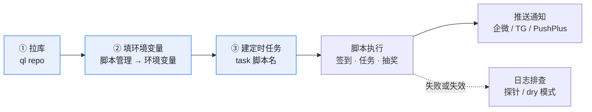

<div align="center">

# 青龙脚本合集

**面向青龙面板的签到 · 任务 · 抽奖自动化脚本库**

微信小程序签到 · App 会员任务 · 积分与红包 · 多账号并发 · 推送通知 · 优先零第三方依赖

[](https://github.com/yang7758258/ohhh_QL-Script)
[](https://github.com/yang7758258/ohhh_QL-Script/fork)
[](https://github.com/yang7758258/ohhh_QL-Script/commits/main)
[](https://github.com/yang7758258/ohhh_QL-Script)
[](#全部脚本)
[](https://github.com/whyour/qinglong)

[**快速开始**](#一快速开始青龙面板) · [**环境变量速查**](#二环境变量速查) · [**更新说明**](#三更新说明) · [**常见问题**](#四常见问题) · [**全部脚本**](#全部脚本) · [**问题反馈**](https://github.com/yang7758258/ohhh_QL-Script/issues)

</div>

> 脚本仅供个人学习与技术研究，仅用于自己有权操作的账号。所有凭据只在你自己的青龙里，仓库不收集任何账号信息。

---

## 按需求找脚本

| 分类 | 项目 | 每天能拿到什么 |
| :--- | :--- | :--- |
| 🛰️ **运营商 · 出行** | [中国联通](https://raw.githubusercontent.com/yang7758258/ohhh_QL-Script/refs/heads/main/unicom_signin.js)（[说明](https://github.com/yang7758258/ohhh_QL-Script/blob/main/README-%E4%B8%AD%E5%9B%BD%E8%81%94%E9%80%9A%E7%AD%BE%E5%88%B0.md)）/ [南方航空](https://raw.githubusercontent.com/yang7758258/ohhh_QL-Script/refs/heads/main/csair_signin.js) / [顺丰速运+](https://raw.githubusercontent.com/yang7758258/ohhh_QL-Script/refs/heads/main/sf_qinglong.js) / [哈啰出行](https://raw.githubusercontent.com/yang7758258/ohhh_QL-Script/refs/heads/main/hellobike_welfare.js) | 话费红包、积分、里程、快递权益与骑行积分 |
| 🛍️ **电商 · 商城** | [OPPO 商城](https://raw.githubusercontent.com/yang7758258/ohhh_QL-Script/refs/heads/main/oppo_store_daily.js)（[取 CK 工具](https://github.com/yang7758258/ohhh_QL-Script/blob/main/README-OPPO%E5%8F%96CK%E5%B7%A5%E5%85%B7.md)）/ [名创优品 MINISO](https://raw.githubusercontent.com/yang7758258/ohhh_QL-Script/refs/heads/main/miniso_signin.js) / [龙湖天街](https://raw.githubusercontent.com/yang7758258/ohhh_QL-Script/refs/heads/main/longhu_signin.js)（[说明](https://github.com/yang7758258/ohhh_QL-Script/blob/main/README-%E9%BE%99%E6%B9%96%E5%A4%A9%E8%A1%97%E7%AD%BE%E5%88%B0.md)） | mini 币、珑珠成长值、商城券与抽奖机会 |
| 🍜 **食品 · 饮料** | [活力伊利](https://raw.githubusercontent.com/yang7758258/ohhh_QL-Script/refs/heads/main/yili_daily.js)（[说明](https://github.com/yang7758258/ohhh_QL-Script/blob/main/README-%E4%BC%8A%E5%88%A9%E7%AD%BE%E5%88%B0.md)）/ [麦斯威尔](https://raw.githubusercontent.com/yang7758258/ohhh_QL-Script/refs/heads/main/mswefls.js) / [海天美味馆](https://raw.githubusercontent.com/yang7758258/ohhh_QL-Script/refs/heads/main/htmwg.js) / [健达福利社](https://raw.githubusercontent.com/yang7758258/ohhh_QL-Script/refs/heads/main/jdfls.js) / [雀巢](https://raw.githubusercontent.com/yang7758258/ohhh_QL-Script/refs/heads/main/qchyjlb.js) / [日清体验馆](https://raw.githubusercontent.com/yang7758258/ohhh_QL-Script/refs/heads/main/rqtyg.js) / [爷爷不泡茶](https://raw.githubusercontent.com/yang7758258/ohhh_QL-Script/refs/heads/main/yybpc.js) / [仰韶](https://raw.githubusercontent.com/yang7758258/ohhh_QL-Script/refs/heads/main/yshyjlb.js) / [毛铺草本荟](https://raw.githubusercontent.com/yang7758258/ohhh_QL-Script/refs/heads/main/mpcbh.js) | 0 元抽奖、积分兑换、试饮试吃名额 |
| 🏠 **家电 · 家居** | [小天鹅](https://raw.githubusercontent.com/yang7758258/ohhh_QL-Script/refs/heads/main/xiaotiane_daily.js) / [顾家家居](https://raw.githubusercontent.com/yang7758258/ohhh_QL-Script/refs/heads/main/gjjj.js) | 鹅仔养成与数字头像、家居积分 |
| ☁️ **云服务** | [雨云](https://raw.githubusercontent.com/yang7758258/ohhh_QL-Script/refs/heads/main/rainyun_signin.js)（[说明](https://github.com/yang7758258/ohhh_QL-Script/blob/main/README-%E9%9B%A8%E4%BA%91%E7%AD%BE%E5%88%B0.md)） | 每日签到 +500 积分与抽奖券 |
| 🎫 **会员 · 权益** | [Keep 奖牌](https://raw.githubusercontent.com/yang7758258/ohhh_QL-Script/refs/heads/main/keep.js) / [好奇车生活](https://raw.githubusercontent.com/yang7758258/ohhh_QL-Script/refs/heads/main/hqcsh.js) / [富士 instax](https://raw.githubusercontent.com/yang7758258/ohhh_QL-Script/refs/heads/main/fsinstax.js) / [Zippo 芝宝](https://raw.githubusercontent.com/yang7758258/ohhh_QL-Script/refs/heads/main/zippo.js) | 奖牌、积分、抽奖与实物兑换 |
| 📱 **短视频 · 内容** | [快手极速版](https://raw.githubusercontent.com/yang7758258/ohhh_QL-Script/refs/heads/main/ks_nebula_daily.js)（[说明](https://github.com/yang7758258/ohhh_QL-Script/blob/main/README-%E5%BF%AB%E6%89%8B%E6%9E%81%E9%80%9F%E7%89%88.md)）/ [招财鸭](https://raw.githubusercontent.com/yang7758258/ohhh_QL-Script/refs/heads/main/ks_duck_signin.js) / [抓鸭子](https://raw.githubusercontent.com/yang7758258/ohhh_QL-Script/refs/heads/main/ks_catch_duck.js) / [看视频](https://raw.githubusercontent.com/yang7758258/ohhh_QL-Script/refs/heads/main/ks_ios_watch.js) | 金币、宝箱、招财鸭饲料、鸭鸭币 |
| 🧰 **公共件** | [sendNotify.js](https://raw.githubusercontent.com/yang7758258/ohhh_QL-Script/refs/heads/main/sendNotify.js) / [Notice.json](https://raw.githubusercontent.com/yang7758258/ohhh_QL-Script/refs/heads/main/Notice.json) | 统一推送通道与远程通知 |

> 点项目名直接下载脚本本体；带「说明」的直接跳完整文档（环境变量全表、取凭据方式、常见问题）。

## 能做什么

<table>
  <tr>
    <td width="50%" valign="top"><b>✅ 签到与任务</b><br>每日签到、连续签到、浏览类任务、周期任务，状态机自己去重，已签自动跳过、重复跑不消耗次数</td>
    <td width="50%" valign="top"><b>🎁 抽奖与兑换</b><br>0 元抽奖、翻牌、抢兑，按活动剩余次数自动跑，不空转</td>
  </tr>
  <tr>
    <td width="50%" valign="top"><b>👥 多账号</b><br>换行或 &amp; 分隔，支持「备注#凭据」写法，备注直接成为推送里的账号名</td>
    <td width="50%" valign="top"><b>🔄 凭据续期</b><br>能续的都续：token 滑动续期、会话缓存复用、失效前告警；不能续的会明确报失效让你重抓</td>
  </tr>
  <tr>
    <td width="50%" valign="top"><b>🛡️ 风控与验证码</b><br>点选验证码自动识别、设备指纹按账号派生、WAF 路径归一化绕过；仍过不去的会如实报状态而不是假装成功</td>
    <td width="50%" valign="top"><b>🔍 只读探针</b><br>多数脚本带 --check / --dry / 探针模式，先看状态不动账号，排错不浪费当天次数</td>
  </tr>
  <tr>
    <td width="50%" valign="top"><b>📮 推送</b><br>统一走 sendNotify，企业微信 / 微信 / TG / PushPlus / Server酱等；推送文案按手机屏宽排版，一条看完</td>
    <td width="50%" valign="top"><b>📦 依赖与隐私</b><br>优先零第三方依赖（纯 Node 内置模块）；仓库只放脚本，token、手机号、青龙地址一律不进库</td>
  </tr>
</table>

## 三步跑起来



---

## 全部脚本

> 维护：[Mist](https://github.com/yang7758258) · 按 Ctrl+F 搜项目名或环境变量名

| # | 项目名称 | 脚本文件 | 环境变量 | 建议定时 | 状态 |
|:-:|:--------|:--------|:--------|:--------|:---:|
| 1 | 中国联通（全功能） | [chinaUnicom.py](https://raw.githubusercontent.com/yang7758258/ohhh_QL-Script/refs/heads/main/chinaUnicom.py) | `chinaUnicomCookie` | `0 7,20 * * *` | ✅ |
| 2 | 中国联通（全任务包装器） | [unicom_tasks.py](https://raw.githubusercontent.com/yang7758258/ohhh_QL-Script/refs/heads/main/unicom_tasks.py) | — | 被 unicom_signin.js 调用 | ✅ |
| 3 | 中国联通（签到） | [unicom_signin.js](https://raw.githubusercontent.com/yang7758258/ohhh_QL-Script/refs/heads/main/unicom_signin.js) | `unicom` | `45 8 * * *` | ✅ |
| 4 | 中国联通（自动登录） | [unicom_auto_login.py](https://raw.githubusercontent.com/yang7758258/ohhh_QL-Script/refs/heads/main/unicom_auto_login.py) | `UNICOM_MOBILE` / `UNICOM_PASSWORD` | 按需 | ✅ |
| 5 | 中国联通（验证码核心） | [cap_solver.py](https://raw.githubusercontent.com/yang7758258/ohhh_QL-Script/refs/heads/main/cap_solver.py) | — | 被调用 | ✅ |
| 6 | 中国联通（云盘活动） | [unicom_cmf.py](https://raw.githubusercontent.com/yang7758258/ohhh_QL-Script/refs/heads/main/unicom_cmf.py) | `unicom_cmf` | 被 unicom_signin.js 调用 | ✅ |
| 7 | 中国联通（项目说明） | [README-中国联通签到.md](https://github.com/yang7758258/ohhh_QL-Script/blob/main/README-%E4%B8%AD%E5%9B%BD%E8%81%94%E9%80%9A%E7%AD%BE%E5%88%B0.md) | — | 文档 | ✅ |
| 8 | 中国南方航空 | [csair_signin.js](https://raw.githubusercontent.com/yang7758258/ohhh_QL-Script/refs/heads/main/csair_signin.js) | `CSAIR_CK` / `CSAIR_ACCOUNT` | `22 8 * * *` | ✅ |
| 9 | OPPO 商城（签到） | [oppo_store_daily.js](https://raw.githubusercontent.com/yang7758258/ohhh_QL-Script/refs/heads/main/oppo_store_daily.js) | `oppo_account` / `oppo_ck` | `10 9 * * *` | ✅ |
| 10 | OPPO 商城（取 CK 面板） | [oppo_ck_panel.js](https://raw.githubusercontent.com/yang7758258/ohhh_QL-Script/refs/heads/main/oppo_ck_panel.js) | 见 [说明](https://github.com/yang7758258/ohhh_QL-Script/blob/main/README-OPPO%E5%8F%96CK%E5%B7%A5%E5%85%B7.md) | 手动运行 | ✅ |
| 11 | OPPO 商城（登录核心） | [oppo_login.js](https://raw.githubusercontent.com/yang7758258/ohhh_QL-Script/refs/heads/main/oppo_login.js) | `OPPO_CHROME` 等 | 被调用 | ✅ |
| 12 | OPPO 商城（面板界面） | [oppo_ck_panel.html](https://raw.githubusercontent.com/yang7758258/ohhh_QL-Script/refs/heads/main/oppo_ck_panel.html) | — | 被面板加载 | ✅ |
| 13 | 龙湖天街（签到） | [longhu_signin.js](https://raw.githubusercontent.com/yang7758258/ohhh_QL-Script/refs/heads/main/longhu_signin.js) | `longhu_token` | `10 8 * * *` | ✅ |
| 14 | 龙湖天街（指纹模块） | [longhu_dxrisk.js](https://raw.githubusercontent.com/yang7758258/ohhh_QL-Script/refs/heads/main/longhu_dxrisk.js) | — | 被主脚本 require | ✅ |
| 15 | 龙湖天街（取 Token 工具） | [龙湖取Token.exe](https://raw.githubusercontent.com/yang7758258/ohhh_QL-Script/refs/heads/main/%E9%BE%99%E6%B9%96%E5%8F%96Token.exe) | — | 手动运行 | ✅ |
| 16 | 龙湖天街（项目说明） | [README-龙湖天街签到.md](https://github.com/yang7758258/ohhh_QL-Script/blob/main/README-%E9%BE%99%E6%B9%96%E5%A4%A9%E8%A1%97%E7%AD%BE%E5%88%B0.md) | — | 文档 | ✅ |
| 17 | 雨云（签到） | [rainyun_signin.js](https://raw.githubusercontent.com/yang7758258/ohhh_QL-Script/refs/heads/main/rainyun_signin.js) | `rainyun_account` | `10 0 * * *` | ✅ |
| 18 | 雨云（验证码识别） | [rainyun_cap.py](https://raw.githubusercontent.com/yang7758258/ohhh_QL-Script/refs/heads/main/rainyun_cap.py) | — | 被主脚本调用 | ✅ |
| 19 | 雨云（项目说明） | [README-雨云签到.md](https://github.com/yang7758258/ohhh_QL-Script/blob/main/README-%E9%9B%A8%E4%BA%91%E7%AD%BE%E5%88%B0.md) | — | 文档 | ✅ |
| 20 | 活力伊利（签到 + 抽奖） | [yili_daily.js](https://raw.githubusercontent.com/yang7758258/ohhh_QL-Script/refs/heads/main/yili_daily.js) | `yili_ck` | `20 11 * * *` | ✅ |
| 21 | 活力伊利（项目说明） | [README-伊利签到.md](https://github.com/yang7758258/ohhh_QL-Script/blob/main/README-%E4%BC%8A%E5%88%A9%E7%AD%BE%E5%88%B0.md) | — | 文档 | ✅ |
| 22 | 小天鹅（鹅仔养成 / 数字头像） | [xiaotiane_daily.js](https://raw.githubusercontent.com/yang7758258/ohhh_QL-Script/refs/heads/main/xiaotiane_daily.js) | `XTE_UC_TOKEN` | `20 9 * * *` | ✅ |
| 23 | 名创优品 MINISO（任务中心） | [miniso_signin.js](https://raw.githubusercontent.com/yang7758258/ohhh_QL-Script/refs/heads/main/miniso_signin.js) | `MINISO_ACCOUNT` | `15 9 * * *` | ✅ |
| 24 | 哈啰出行（小程序福利中心） | [hellobike_welfare.js](https://raw.githubusercontent.com/yang7758258/ohhh_QL-Script/refs/heads/main/hellobike_welfare.js) | `HELLOBIKE_ACCOUNT` | `20 9 * * *` | ✅ |
| 25 | 快手极速版（主站金币） | [ks_nebula_daily.js](https://raw.githubusercontent.com/yang7758258/ohhh_QL-Script/refs/heads/main/ks_nebula_daily.js) | `ks_ck` | `5 8,12,18,21 * * *` | ✅ |
| 26 | 快手极速版（招财鸭） | [ks_duck_signin.js](https://raw.githubusercontent.com/yang7758258/ohhh_QL-Script/refs/heads/main/ks_duck_signin.js) | `ks_ck` | `10 8,12,18,21 * * *` | ✅ |
| 27 | 快手极速版（抓鸭子） | [ks_catch_duck.js](https://raw.githubusercontent.com/yang7758258/ohhh_QL-Script/refs/heads/main/ks_catch_duck.js) | `ks_ck` | `20 9,15,21 * * *` | ✅ |
| 28 | 快手极速版（看视频） | [ks_ios_watch.js](https://raw.githubusercontent.com/yang7758258/ohhh_QL-Script/refs/heads/main/ks_ios_watch.js) | `ks_gw` | `0 9,13,19,22 * * *` | ✅ |
| 29 | 快手极速版（项目说明） | [README-快手极速版.md](https://github.com/yang7758258/ohhh_QL-Script/blob/main/README-%E5%BF%AB%E6%89%8B%E6%9E%81%E9%80%9F%E7%89%88.md) | — | 文档 | ✅ |
| 30 | 顺丰速运+ | [sf_qinglong.js](https://raw.githubusercontent.com/yang7758258/ohhh_QL-Script/refs/heads/main/sf_qinglong.js) | `SfsyUrl` | `0 9 * * *` | ✅ |
| 31 | 麦斯威尔福利社 | [mswefls.js](https://raw.githubusercontent.com/yang7758258/ohhh_QL-Script/refs/heads/main/mswefls.js) | `mswefls` | `10 12 * * *` | ✅ |
| 32 | Keep 奖牌 | [keep.js](https://raw.githubusercontent.com/yang7758258/ohhh_QL-Script/refs/heads/main/keep.js) | `Keep` | `10 12 * * *` | ✅ |
| 33 | 顾家家居 | [gjjj.js](https://raw.githubusercontent.com/yang7758258/ohhh_QL-Script/refs/heads/main/gjjj.js) | `gjjj` | `0 7,17 * * *` | ✅ |
| 34 | 好奇车生活 | [hqcsh.js](https://raw.githubusercontent.com/yang7758258/ohhh_QL-Script/refs/heads/main/hqcsh.js) | `hqcsh` | `0 6,18 * * *` | ✅ |
| 35 | 海天美味馆 | [htmwg.js](https://raw.githubusercontent.com/yang7758258/ohhh_QL-Script/refs/heads/main/htmwg.js) | `htmwg` | `0 9,18 * * *` | ✅ |
| 36 | 健达福利社 | [jdfls.js](https://raw.githubusercontent.com/yang7758258/ohhh_QL-Script/refs/heads/main/jdfls.js) | `jdfls` | `10 11,12 * * *` | ✅ |
| 37 | 富士 instax | [fsinstax.js](https://raw.githubusercontent.com/yang7758258/ohhh_QL-Script/refs/heads/main/fsinstax.js) | `fsinstax` | `10 8 * * *` | ✅ |
| 38 | 仰韶会员俱乐部 | [yshyjlb.js](https://raw.githubusercontent.com/yang7758258/ohhh_QL-Script/refs/heads/main/yshyjlb.js) | `yshyjlb` | `10 10,16 * * *` | ✅ |
| 39 | 毛铺草本荟 | [mpcbh.js](https://raw.githubusercontent.com/yang7758258/ohhh_QL-Script/refs/heads/main/mpcbh.js) | `mpcbh` | `30 8,18 * * *` | ✅ |
| 40 | 雀巢会员俱乐部 | [qchyjlb.js](https://raw.githubusercontent.com/yang7758258/ohhh_QL-Script/refs/heads/main/qchyjlb.js) | `qchyjlb` | `0 9 * * *` | ✅ |
| 41 | 日清体验馆 | [rqtyg.js](https://raw.githubusercontent.com/yang7758258/ohhh_QL-Script/refs/heads/main/rqtyg.js) | `rqtyg` | `30 6 * * *` | ✅ |
| 42 | 爷爷不泡茶 | [yybpc.js](https://raw.githubusercontent.com/yang7758258/ohhh_QL-Script/refs/heads/main/yybpc.js) | `yybpc` | `10 8 * * *` | ✅ |
| 43 | Zippo 芝宝 | [zippo.js](https://raw.githubusercontent.com/yang7758258/ohhh_QL-Script/refs/heads/main/zippo.js) | `zippo` | `0 0,7 * * *` | ✅ |
| 44 | 推送模块 | [sendNotify.js](https://raw.githubusercontent.com/yang7758258/ohhh_QL-Script/refs/heads/main/sendNotify.js) | 见文件内注释 | 被调用 | 公共件 |
| 45 | 远程通知 | [Notice.json](https://raw.githubusercontent.com/yang7758258/ohhh_QL-Script/refs/heads/main/Notice.json) | — | 被调用 | 公共件 |

---

## 一、快速开始（青龙面板）

```bash
# 1. 拉库
ql repo https://github.com/yang7758258/ohhh_QL-Script.git "js$|py$" "" "sendNotify"

# 2. 装依赖（Python 脚本需要）
pip3 install requests pycryptodome
```

也可以手动：**脚本管理 → 新建脚本** → 粘贴代码 → **环境变量** 按上表填写。

---

## 二、环境变量速查

> 共 14 个条目，**点开对应项目**看完整变量表与示例。每一项后面是该脚本的必需变量名。

<details>
<summary><b>中国联通 chinaUnicom.py（全功能版）</b>  ·  <code>chinaUnicomCookie</code></summary>

```bash
# 三选一，多账号用 & 或换行分隔
export chinaUnicomCookie="手机号#登录密码"     # 自动取 Token，推荐
export chinaUnicomCookie="Token#AppId"        # 免密模式
export chinaUnicomCookie="Token"              # 仅 Token

# 可选
export UNICOM_PROXY_API="代理提取链接"
export UNICOM_PROXY_TYPE="socks5"             # http / socks5
export UNICOM_GRAB_AMOUNT="5"                 # 抢兑面额
export UNICOM_TEST_MODE="query"               # 只查资产不跑任务
```

覆盖模块：首页签到 / 联通祝福 / 天天领现金 / 权益超市 / 安全管家 / 联通云盘 / 联通阅读 / 联通爱听 / 沃云手机 / 区域专区。

</details>

<details>
<summary><b>中国联通 unicom_tasks.py（全任务包装器）</b>  ·  无需配置 · 被主脚本调用</summary>

不需要单独配置。`unicom_signin.js` 完成签到后会自动调用它，复用已拿到的 `ecs_token` 跳过登录链，跑 `chinaUnicom.py` 的 10 个模块。

```bash
export unicom_all="on"           # 扩展任务总开关，默认 on
export unicom_all_skip="enable_woread,enable_aiting"   # 跳过指定模块
export unicom_woread="off"       # 单独关闭阅读
```

> 前提：`chinaUnicom.py`、`unicom_tasks.py`、`unicom_signin.js` 三个文件在同一目录。

</details>

<details>
<summary><b>中国联通 unicom_signin.js</b>  ·  <code>unicom</code></summary>

```bash
export unicom="手机号:登录密码"                # 推荐，全自动
export unicom="主号#手机号:登录密码"           # 带备注
export unicom="手机号:登录密码"                # 多账号换行分隔

export unicom_pwd="登录密码"                   # 单独提供密码
export unicom_ck="ecs_token"                   # 已有 token 时的兜底
export unicom_tasks="on"                       # 任务中心开关
export unicom_monthsign="on"                   # 月签有礼
export unicom_cmf="on"                         # 云盘乘风破浪2026（需 unicom_cmf.py + lt_cmf2026.py）
export unicom_probe="on"                       # 只探针，不签到

# 推送排版：simple 一账号一行（默认）/ full 旧版逐条明细
export unicom_push_style="simple"

# 设备指纹：同一账号永远同一台设备，改 seed 等于换一台「新手机」
export unicom_device_seed="mist-2026"
export unicom_device_os="17.6.1"
```

> 完整说明（环境变量全表、推送样式、自动续期三种落地方式、常见问题）：
> [README-中国联通签到.md](https://github.com/yang7758258/ohhh_QL-Script/blob/main/README-%E4%B8%AD%E5%9B%BD%E8%81%94%E9%80%9A%E7%AD%BE%E5%88%B0.md)

</details>

<details>
<summary><b>中国南方航空 csair_signin.js</b>  ·  <code>CSAIR_CK</code> / <code>CSAIR_ACCOUNT</code></summary>

```bash
export CSAIR_CK="cs1246643sso 的值"            # 通道A，多账号换行
export CSAIR_ACCOUNT="手机号#密码#openId#unionId"  # 通道B

export CSAIR_MODE="all"                        # all / sign / probe
export CSAIR_DELAY="6-15"                      # 多账号间隔秒
export CSAIR_NOTIFY="0"                        # 关闭推送
```

</details>

<details>
<summary><b>OPPO 商城 oppo_store_daily.js</b>  ·  <code>oppo_account</code> / <code>oppo_ck</code></summary>

```bash
# 二选一，也可以都配（oppo_account 优先，oppo_ck 作兜底）
export oppo_account="手机号#密码"        # 推荐，自动登录，多账号换行
export oppo_ck="TOKEN_eyJhbGciOi..."     # 兜底，TOKENSID 约 30 天 / 也接受 NEWOPPOSID=xxx

# 可选
export oppo_push="on"                    # on / off / dry（dry 只打印不发送）
export oppo_delay="3-8"                  # 多账号间隔秒
export oppo_browse="on"                  # 任务前真去 GET 一次落地页
export oppo_raffle_max="20"              # 单活动最多抽几次
export oppo_activities=""                # 追加任务活动 ID，逗号分隔
export oppo_raffles=""                   # 追加抽奖活动 ID，逗号分隔
export oppo_sign_activity="2116078703745441792"
export oppo_login_off="off"              # on = 跳过密码登录，只用 oppo_ck
export oppo_debug="off"                  # on = 打印原始响应
```

密码登录需要本机有浏览器（自动探测 Chrome / Edge）：

```bash
export OPPO_CHROME=""                    # 浏览器可执行文件路径
export OPPO_BROWSER_PROFILE="~/.oppo-store-profile"   # 持久化才有会话复用
export OPPO_HEADLESS="1"                 # 0 = 有头，本地排错用
export OPPO_DEBUG_PORT="9333"            # CDP 端口
export OPPO_SMS_CODE=""                  # 触发短信二次验证时用
export OPPO_SMS_FILE=""                  # 短信验证码文件（脚本轮询）
```

> 三个文件要一起放：`oppo_store_daily.js` + `oppo_login.js` + `sendNotify.js`。

</details>

<details>
<summary><b>OPPO 商城取 CK 面板 oppo_ck_panel.js</b>  ·  无需配置 · 配套面板</summary>

没有凭据时用它：输手机号 → 收短信 → 拿凭据 → **先校验可用** → 一键写进青龙 `oppo_ck`。

> 2026-11-04 起，抓到的 cookie 会先拿去打一次会员信息接口，接口认了才收下 ——
> 不会出现「塞进青龙才发现不能用」。候选里有 TOKENSID（约 30 天）就优先用它，
> 只有 NEWOPPOSID（约 1 天）时才退回短凭据。

```bash
node oppo_ck_panel.js                    # 默认起本地面板，自动开浏览器
node oppo_ck_panel.js --port 7788 --open
```

同目录需要 `oppo_login.js` + `oppo_ck_panel.html`。

**不想装 Node？用打包好的 exe（需下载，不进仓库）：**

> 📦 [OPPO-Shop-CK-Tool-v1.2.exe](https://github.com/yang7758258/ohhh_QL-Script/releases/download/v1.2/OPPO-Shop-CK-Tool-v1.2.exe) · 约 71 MB · 单文件便携版，双击即用
>
> SHA256 `4deea086f241c4d38d37d916a758aae85f780313ce2fbe84ad47ccff40391cc6`
> 完整说明：[README-OPPO取CK工具.md](https://github.com/yang7758258/ohhh_QL-Script/blob/main/README-OPPO%E5%8F%96CK%E5%B7%A5%E5%85%B7.md) · 全部 Release：[releases](https://github.com/yang7758258/ohhh_QL-Script/releases)

</details>

<details>
<summary><b>龙湖天街 longhu_signin.js</b>  ·  <code>longhu_token</code></summary>

```bash
export longhu_token="主号#a1b2c3d4e5f6a7b8c9d0e1f2a3b4c5d6#pixel7"   # token，多账号换行
export longhu_app="auto"            # APP 入口：auto 真签 / manual 只查 / off 关
export longhu_push="on"             # on / off / dry（只打印不发）
export longhu_push_style="simple"   # simple 紧凑一条 / full 每号一段（排错用）
export longhu_delay="5-15"          # 多账号随机间隔（秒）
```

| 变量 | 必需 | 默认 | 说明 |
| :--- | :---: | :--- | :--- |
| `longhu_token` | ✅ | — | 三种写法：`token` / `备注#token` / `备注#token#机型`，多账号换行 |
| `longhu_dx` | ⬜ | 空 | 真机 App 指纹，一般不用填（脚本自动签发） |
| `longhu_dx_profile` | ⬜ | `pixel7` | pixel7 / xiaomi14 / oneplus12 / vivo_x100 / samsung_s24 |
| `longhu_dx_fresh` | ⬜ | `off` | on = 丢缓存重签指纹（换机或被打风控后用） |
| `longhu_app` | ⬜ | `auto` | APP 入口模式 |
| `longhu_push` | ⬜ | `on` | 推送开关 |
| `longhu_push_style` | ⬜ | `simple` | 推送版式 |
| `longhu_delay` | ⬜ | `5-15` | 多账号间隔 |
| `longhu_debug` | ⬜ | `off` | on 打印原始报文 |

> token 有效期 30 天且滑动续期，拿一次就够。取 token 用 `龙湖取Token.exe`（手机号 + 短信验证码）
> 或 `grab_longhu_token.js`（从 HAR / cURL 抠）。完整说明：[README-龙湖天街签到.md](https://github.com/yang7758258/ohhh_QL-Script/blob/main/README-%E9%BE%99%E6%B9%96%E5%A4%A9%E8%A1%97%E7%AD%BE%E5%88%B0.md)

> ⚠️ 同目录的 `longhu_dx_cache.json` / `longhu_token.json` / `取Token-设置.json` / `取Token-指纹.json` 是本机运行产物，含 token、手机号、青龙密码，**不要提交不要外传**。

</details>

<details>
<summary><b>雨云 rainyun_signin.js</b>  ·  <code>rainyun_account</code></summary>

```bash
export rainyun_account="手机号#密码"      # 多账号用 & 或换行
export rainyun_push="1"                  # 填任意值即开启推送
export rainyun_captcha="auto"            # auto / off（off 只跑免票通道）
export rainyun_debug="1"                 # 1 打印识别细节 / force 已领取也强制提交
```

| 变量 | 必需 | 说明 |
| :--- | :---: | :--- |
| `rainyun_account` | ✅ | `手机号#密码`，多账号 `&` 或换行分隔 |
| `rainyun_push` | ⬜ | 填任意值开启推送（走 `sendNotify.js`） |
| `rainyun_captcha` | ⬜ | `auto`（默认）/ `off` |
| `rainyun_debug` | ⬜ | `1` 识别细节 / `force` 强制重提交 |
| `YZ_CHROME` | ⬜ | 浏览器路径，青龙已内置 |
| `RY_PYTHON` | ⬜ | 指定 python3，默认自动探测 |

> 三个文件（`rainyun_signin.js` + `rainyun_cap.py` + `sendNotify.js`）必须平铺在同一目录。
> 命令要带 `task` 前缀（`task rainyun_signin.js`），否则 NODE_PATH 不带依赖缓存，require 会失败。
> 完整说明：[README-雨云签到.md](https://github.com/yang7758258/ohhh_QL-Script/blob/main/README-%E9%9B%A8%E4%BA%91%E7%AD%BE%E5%88%B0.md)

</details>

<details>
<summary><b>活力伊利 yili_daily.js</b>  ·  <code>yili_ck</code></summary>

```bash
export yili_ck="大号#access-token"     # 必填，多账号换行或 & 分隔
export yili_draw="5"                  # 单号最多抽几次（真实上限看活动剩余）
export yili_push="on"                 # on / off / dry（只打印不发）
export yili_push_style="simple"       # simple 一条看完 / full 每号一段
export yili_delay="3-8"               # 多账号间隔秒数
```

| 变量 | 必需 | 默认 | 说明 |
| :--- | :---: | :--- | :--- |
| `yili_ck` | ✅ | — | access-token，多号换行或 `&`，支持 `备注#token` |
| `yili_activity` | ⬜ | 活动 ID | 抽奖活动 ID，一般不改 |
| `yili_draw` | ⬜ | `5` | 单号最多抽几次 |
| `yili_push` | ⬜ | `on` | on / off / dry |
| `yili_push_style` | ⬜ | `simple` | 推送版式 |
| `yili_delay` | ⬜ | `3-8` | 多账号间隔 |
| `yili_debug` | ⬜ | `off` | on 打印真实请求路径与 403/WAF |
| `yili_check` | ⬜ | `off` | on 只做 ck 体检（等同 `--check`） |

> access-token 只有 80 字节密文，**没有可读的 exp**，服务端也不回过期时间 —— 脚本按官方 5 天窗口推，
> 超过 96 小时会在终端告警、推送里加「建议重抓」。随时手动体检：`node yili_daily.js --check`（退出码 0=可用 / 2=失效）。

> 状态里有个 `⏳ 已提交待落库` —— 接口回 `status:true` 且有奖励明细，但状态/日历/积分三项都没变。
> 这是如实上报，脚本不用 `status:true` 冒充签到成功。完整说明：[README-伊利签到.md](https://github.com/yang7758258/ohhh_QL-Script/blob/main/README-%E4%BC%8A%E5%88%A9%E7%AD%BE%E5%88%B0.md)

</details>

<details>
<summary><b>小天鹅 xiaotiane_daily.js</b>  ·  <code>XTE_UC_TOKEN</code></summary>

```bash
export XTE_UC_TOKEN="64位hex"            # 主凭证，小程序 ucAccessToken
export XTE_PHONE="手机号"                 # 可选，配合密码做账号校验 / 换会话
export XTE_PASSWORD="密码"                # 可选，同上
export XTE_WX_JSCODE=""                   # 可选，wx.login() 的 code，用于续 30 天会话
export XTE_MODULES="swan,avatar,feed"     # 跑哪些模块，默认全跑
export XTE_PUSH="on"                      # on / off
```

| 变量 | 必需 | 说明 |
| :--- | :---: | :--- |
| `XTE_UC_TOKEN` | ✅ | 小程序 `ucAccessToken`（64 位 hex），主凭证 |
| `XTE_PHONE` / `XTE_PASSWORD` | ⬜ | 账号密码登录（美的 UC 统一认证），可自动换取并续期 |
| `XTE_WX_JSCODE` | ⬜ | `wx.login()` 的 code，用于把 30 天会话续期 |
| `XTE_MODULES` | ⬜ | `swan` 鹅仔 / `avatar` 数字头像 / `feed` 喂青草，逗号分隔，默认全跑 |
| `XTE_PUSH` | ⬜ | `on`（默认）/ `off` |

> 跑起来会往同目录写 `xte_state.json`（会话与任务状态），**含凭据，别提交**。

</details>

<details>
<summary><b>名创优品 MINISO miniso_signin.js</b>  ·  <code>MINISO_ACCOUNT</code></summary>

```bash
export MINISO_ACCOUNT="skey#uid"          # 多账号 & 或换行分隔，也接受 JSON
export MINISO_PUSH="on"                   # on / off
```

| 变量 | 必需 | 说明 |
| :--- | :---: | :--- |
| `MINISO_ACCOUNT` | ✅ | `skey#uid`，多账号 `&` 或换行；也接受 JSON 数组 |
| `MINISO_PUSH` | ⬜ | `on`（默认）/ `off` |

> 只有 `浏览类`（taskType=5）任务能无人值守完成；邀请好友、加群类需要人工，脚本会跳过。
> 本地调试可跑 `node miniso_signin.js --dry` 只读巡检，不提交领奖。

</details>

<details>
<summary><b>哈啰出行 hellobike_welfare.js</b>  ·  <code>HELLOBIKE_ACCOUNT</code></summary>

```bash
export HELLOBIKE_ACCOUNT="token#cityCode#adCode#备注"   # 多账号 & 或换行
export HELLOBIKE_VIDEO="full"        # full 刷满当日阶梯 / 数字封顶 / 0 只签到
export HELLOBIKE_ALIPAY="on"         # 是否顺带做「看视频抵扣」
export HELLOBIKE_CITY="0733"         # 缺省城市码，改成自己的城市
export HELLOBIKE_PUSH="on"           # on / off
```

| 变量 | 必需 | 默认 | 说明 |
| :--- | :---: | :--- | :--- |
| `HELLOBIKE_ACCOUNT` | ✅ | — | `token#cityCode#adCode#备注`，后两段可留空，多号 `&` 或换行 |
| `HELLOBIKE_VIDEO` | ⬜ | `full` | 看视频档数上限：full 全刷 / 数字封顶 / 0 只签到 |
| `HELLOBIKE_ALIPAY` | ⬜ | `on` | 是否顺带做看视频抵扣 |
| `HELLOBIKE_ALIPAY_ROUNDS` | ⬜ | `10` | 抵扣通道单次观看数 |
| `HELLOBIKE_CITY` / `HELLOBIKE_ADCODE` | ⬜ | `0733` / `430211` | 缺省城市与行政区码 |
| `HELLOBIKE_LON` / `HELLOBIKE_LAT` | ⬜ | 中性默认值 | 请求里的定位，服务端不校验 |
| `HELLOBIKE_STATE` | ⬜ | `on` | 是否写登录态缓存 `hellobike_state.json` |
| `HELLOBIKE_PUSH` | ⬜ | `on` | on / off |

> 只读自检三件套：`--check` 验登录态与到期、`--dry` 只读巡检不发领奖、`--preview` 打印推送原文不发通知。
>
> 激励视频走 `adx.ssp.show` → `adx.ssp.callback` 的 LOAD/SHOWED/COMPLETE 三段回调，奖励按回调发放，脚本会把三段都打完。

</details>

<details>
<summary><b>快手极速版 ks_nebula_daily.js</b>  ·  <code>ks_ck</code></summary>

```bash
export ks_ck="备注#完整Cookie"        # 必填，多账号换行
export ks_box_wait="off"             # on = 宝箱冷却到了自动等并连开
export ks_box_max="20"               # 单次最多开几个宝箱
export ks_delay="5-15"               # 多账号间隔秒
export ks_push="on"                  # on / off
export ks_debug="off"                # on 打印原始响应体
```

| 变量 | 必需 | 默认 | 说明 |
| :--- | :---: | :--- | :--- |
| `ks_ck` | ✅ | — | Cookie 整串，多账号换行，支持 `备注#Cookie` |
| `ks_box_wait` | ⬜ | `off` | on = 自动等冷却并连开（单次最长约 100 分钟） |
| `ks_box_max` | ⬜ | `20` | 单次最多开几个宝箱 |
| `ks_delay` | ⬜ | `5-15` | 多账号随机间隔 |
| `ks_push` | ⬜ | `on` | 推送开关，另受 `TYpush=off` 影响 |
| `ks_debug` | ⬜ | `off` | on 打印原始报文 |

> 同项目还有三个脚本：`ks_duck_signin.js`（招财鸭，需 playwright）、`ks_catch_duck.js`（抓鸭子）、`ks_ios_watch.js`（看视频，需 `ks_gw` 网关）。
>
> **密码登录是死的** —— 服务端对正确/错误/不存在三种输入返回同一个码 `100110150`，是策略级拦截。只能走 Cookie，且 SSO 不公开续期，过期必须重抓。
>
> 完整说明（取 Cookie 姿势、kpn 坑、返回码对照、能力边界）：[README-快手极速版.md](https://github.com/yang7758258/ohhh_QL-Script/blob/main/README-%E5%BF%AB%E6%89%8B%E6%9E%81%E9%80%9F%E7%89%88.md)

</details>

<details>
<summary><b>顺丰速运+ sf_qinglong.js</b>  ·  <code>SfsyUrl</code></summary>

```bash
export SfsyUrl="suuid=xxx; sessionId=xxx; _login_mobile_=xxx"   # 必填
export sfck="suuid"                            # 单填 suuid 时的补充
export sfsess="sessionId"                      # 单填 sessionId 时的补充
export sfcheck="1"                             # 自检模式
export sfkeep="1"                              # 保活模式
export sf_tasks="off"                          # 跳过任务只签到
```

</details>

<details>
<summary><b>其余微信小程序脚本</b>  ·  各脚本变量名见表格</summary>

统一格式 `export <变量名>= <凭证>`，多账号换行或 `#` 分隔。变量名见上表，每个脚本头部注释里也写了抓包位置。

---

</details>

## 三、更新说明

| 日期 | 内容 |
|:---|:---|
| **2026-11-22** | 📱 **新增快手极速版四件套**：`ks_nebula_daily.js`（签到 + 开宝箱 + 任务卡领奖 + 51 任务上报，纯 HTTP 零依赖）、`ks_duck_signin.js`（招财鸭签到 / 喂食 / 领奖 / 饲料仓 / 饲料雨，Playwright 跑真实页面）、`ks_catch_duck.js`（抓鸭子 init → report 自动上报）、`ks_ios_watch.js`（看视频，网关驱动 App 真实播放）<br>📄 [README-快手极速版.md](https://github.com/yang7758258/ohhh_QL-Script/blob/main/README-%E5%BF%AB%E6%89%8B%E6%9E%81%E9%80%9F%E7%89%88.md) 含 kpn 坑、返回码对照与能力边界（诚实版）<br>🔒 隐私审查：移除作者内网 IP 与设备地址，四份脚本无手机号 / Cookie / 青龙凭据 |
| **2026-11-15** | 🚲 **新增哈啰出行**：`hellobike_welfare.js`（福利中心签到 + 连签奖励金 20/40/60/80 积分、激励视频阶梯 12/10/10/7、看视频抵扣、积分与奖励金结算播报）<br>🔒 隐私审查：抓包定位改为环境变量可覆盖 + 中性默认，移除地市名 |
| **2026-11-15** | 🦢 **新增小天鹅**：`xiaotiane_daily.js`（鹅仔签到 / 鹅仔日常任务 / 鹅仔工作 / 喂青草 / 数字头像任务，账号密码登录走美的 UC 统一认证，Bearer 10 天滚动续期）<br>🛍 **新增名创优品 MINISO**：`miniso_signin.js`（签到领 mini币 / 周期任务自动浏览并领奖 / 当日 mini币结算播报）<br>🔒 隐私审查：两份脚本均无手机号、token、内网地址与本机路径<br>🧹 脚本内只保留代码注释与作者声明，不含使用说明等额外文档 |
| **2026-11-14** | 🥛 **新增活力伊利**：`yili_daily.js`（每日签到 + 0 元抽奖 + 积分回显，签到状态/签到/日历三路交叉确认，403/WAF 两档绕过，推送按 iPhone 气泡 34 列排版）<br>🔑 取 token 只需抓一次包，从请求头复制 `access-token`，无需额外工具<br>📄 [README-伊利签到.md](https://github.com/yang7758258/ohhh_QL-Script/blob/main/README-%E4%BC%8A%E5%88%A9%E7%AD%BE%E5%88%B0.md) 含 ck 寿命推算与状态语义说明<br>🔒 隐私清理：取 ck 工具不内置青龙地址/账号/密码，连接信息只从环境变量读；文档手机号与本机路径全部脱敏 |
| **2026-11-10** | 🏬 **新增龙湖天街**：`longhu_signin.js`（小程序 + APP 双入口签到、token 滑动续期 30 天、顶象设备指纹、紧凑推送）+ `longhu_dxrisk.js`（XXTEA 指纹签发模块）+ `龙湖取Token.exe`（手机号 + 验证码直接换 token，附 `TakeToken.cs` 源码可自行编译）<br>☁️ **新增雨云**：`rainyun_signin.js`（签到 +500 积分、腾讯点选验证码自动过、7 天会话复用）+ `rainyun_cap.py`（提示切分 + 候选检测 + 双通道打分）<br>📄 两份项目说明一并发布<br>🔒 隐私清理：取 Token 工具与抓包脚本不内置任何青龙地址/账号/密码，连接信息只从环境变量读；文档中的手机号、用户 ID、本机路径全部脱敏 |
| **2026-11-07** | 📮 **中国联通** `unicom_signin.js` v1.3：推送新增**紧凑排版**（`unicom_push_style` = simple/full），一账号一行、扩展任务压一行，full 保留旧版逐条明细<br>📖 补全接口与坑位说明：鉴权最小集（43 → 1 个 cookie）、密码登录四步、失效码字典、token 寿命实测 25.5h<br>🧩 新增 `unicom_cmf.py` 云盘活动包装器（乘风破浪2026），复用 ecs_token 走二级缓存登录<br>📄 新增 [README-中国联通签到.md](https://github.com/yang7758258/ohhh_QL-Script/blob/main/README-%E4%B8%AD%E5%9B%BD%E8%81%94%E9%80%9A%E7%AD%BE%E5%88%B0.md) 完整说明<br>🔒 隐私清理：移除作者本机绝对路径，UA 系统版本改由环境变量控制 |
| **2026-11-04** | 🎈 **OPPO 取 CK 工具 v1.2**：抓到凭据后**先校验再用**——逐个候选打会员信息接口，接口认了才收，失败会打印每个候选的原因（`code=5008` 过期 / `login=false` 登录没落稳 / `HTTP 403` 被拦）<br>🔧 **凭据优选** TOKENSID（约 30 天）＞ NEWOPPOSID（约 1 天）<br>🖥 面板显示校验结果：类型 / 账号名 / 积分 / 有效期<br>📄 新增 [README-OPPO取CK工具.md](https://github.com/yang7758258/ohhh_QL-Script/blob/main/README-OPPO%E5%8F%96CK%E5%B7%A5%E5%85%B7.md) 完整说明<br>📦 [v1.2 exe](https://github.com/yang7758258/ohhh_QL-Script/releases/tag/v1.2) 已发布 |
| **2026-11-03** | 🐞 **中国联通** 修复「设备登录过多」：设备码改为按账号确定性派生（`unicom_auto_login.py` 去掉写死常量、`unicom_signin.js` 不再每次随机、`chinaUnicom.py` 的 uuid / sdkuuid / 云盘设备号统一派生），同一账号永远同一台设备<br>🔒 UA 去掉真机型号（iPhone17,1 / iOS 26.6.1），改为中性机型，可用 `unicom_device_model` / `unicom_device_os` / `unicom_device_seed` 覆盖 |
| **2026-11-02** | 📄 **新增** OPPO 商城四件套：`oppo_store_daily.js`（签到 + 日常任务 + 活动任务 + 抽奖 v1.1）、`oppo_login.js`（账号密码登录 / 取 CK 核心）、`oppo_ck_panel.js` + `oppo_ck_panel.html`（短信登录取 CK 面板）<br>🔧 统一「项目名称 + 更新说明」头部标识，修正头部版本号与运行时横幅不一致 |
| **2026-11-01** | 🔧 **中国联通** `unicom_signin.js` v1.3：补齐 token 失效自动续期链路<br>🔧 **中国联通** `unicom_auto_login.py`：验证码服务地址改为环境变量，移除硬编码<br>📦 **仓库整理**：全脚本补充「项目名称 + 更新说明」头部标识<br>🧹 **隐私清理**：清除脚本内的手机号、内网 IP、个人信息<br>🗂️ **结构清理**：移除废弃目录，README 重写并修正全部链接<br>📄 **新增** `unicom_auto_login.py` / `cap_solver.py`<br>📄 **新增** `chinaUnicom.py`（全功能 v1.0.5）+ `unicom_tasks.py`（全任务包装器），扩展任务链路打通 |
| 2026-10-20 | 顺丰速运+ v3 抓包实证版 |
| 2026-02-06 | Keep 奖牌新增 |
| 2026-02-05 | 麦斯威尔福利社优化浇水逻辑 |
| 2024-06-18 | 仓库初始版本 |

---

## 四、常见问题

**Q：提示「未登录 / 0001」？**  
Token 过期。重新抓包更新环境变量；联通 `unicom_signin.js` 配了密码会自动续期。

**Q：签到成功但没到账？**  
看脚本日志里的返回码。`0002` 是今天已签到（幂等，不是错误），`0329` 是任务失败（软失败，可跳过）。

**Q：多个账号怎么写？**  
换行，或用 `#` / `&` 分隔（各脚本头注释里注明了该脚本支持的分隔符）。

**Q：脚本跑完没推送？**  
把 `sendNotify.js` 一起放到同目录，并配置推送环境变量。

---

### [群组直达 | 我与我周旋久，宁做我](https://t.me/Mist154)
### [频道直达 | 夜色四合，平安喜樂](https://t.me/Mist153)

### See You.

---

## 声明

- 这里的脚本只是自己学习的一个实践。
- 仅用于测试和学习研究，禁止用于商业用途，不能保证其合法性、准确性、完整性和有效性，请根据情况自行判断。
- 仓库内所有资源文件，禁止任何公众号、自媒体进行任何形式的转载、发布。
- `Mist` 对任何脚本问题概不负责，包括但不限于由任何脚本错误导致的任何损失或损害。
- 间接使用脚本的任何用户，包括但不限于建立 VPS 或在某些行为违反国家/地区法律或相关法规的情况下进行传播，`Mist` 对于由此引起的任何隐私泄漏或其他后果概不负责。
- 如果任何单位或个人认为该项目的脚本可能涉嫌侵犯其权利，则应及时通知并提供身份证明、所有权证明，我们将在收到认证文件后删除相关脚本。
- 任何以任何方式查看此项目的人或直接或间接使用该 Script 项目的任何脚本的使用者都应仔细阅读此声明。`Mist` 保留随时更改或补充此免责声明的权利。一旦使用并复制了任何相关脚本或 Script 项目的规则，则视为您已接受此免责声明。
- 您必须在下载后的 24 小时内从计算机或手机中完全删除以上内容。
